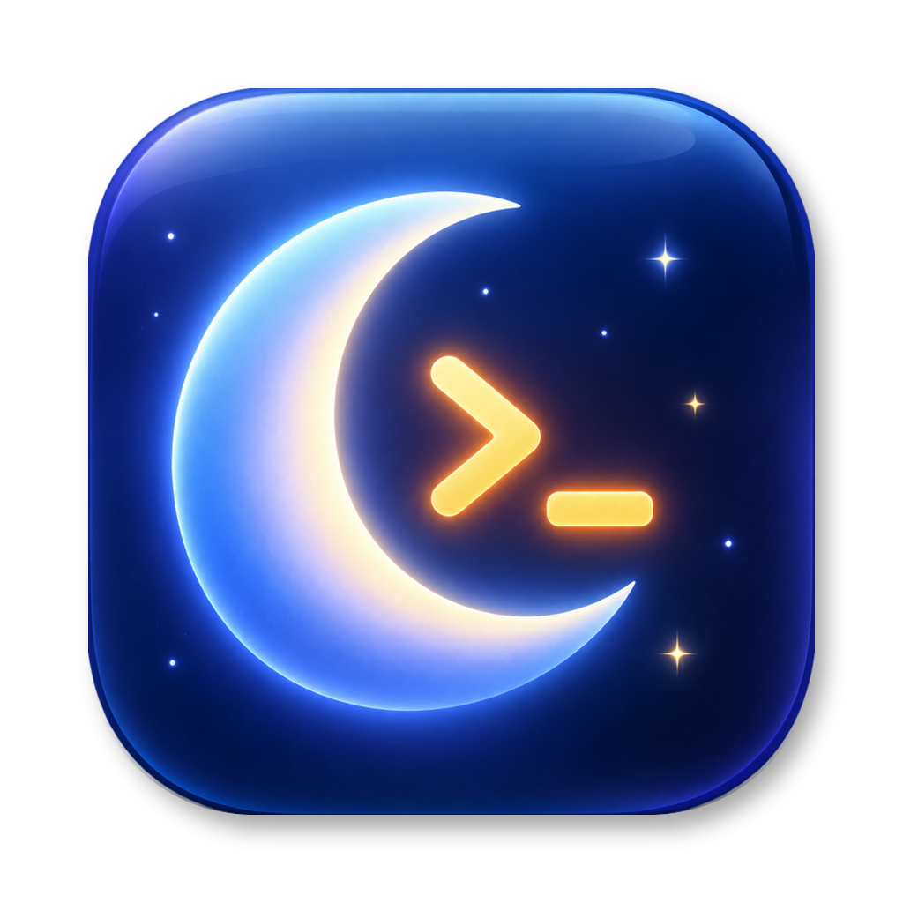

<p align="center"></p>

<h1 align="center">Agent Awake</h1>

<p align="center"><b>caffeinate for AI agents.</b> Your Mac stays awake while agents work,<br>
sleeps the moment they're done, and your phone tells you.</p>

---

Leaving Claude Code, Codex or a long build running and walking away means choosing between a Mac that
sleeps mid-task and one that burns battery all night with `caffeinate`. Agent Awake holds the Mac awake
**only while work is actually running**, then lets it sleep and pings your phone.

- **Awake only while agents work.** Each agent or job is a session. While any session is alive the Mac
  doesn't idle-sleep. When the last one ends, normal sleep comes back by itself.
- **The screen still dims.** Only system sleep is held, not the display, so an unattended Mac goes dark
  and saves power while the work continues.
- **Phone pings.** "Fix login bug done", "build timed out", "blocked: it needs you", sent through
  [ntfy](https://ntfy.sh) to your iPhone or Android phone. Setup takes a QR scan.
- **Stuck detection.** A session that goes silent past its timeout is released and you're told.
- **Lid closed (optional).** Keep agents running in your bag. A small privileged helper turns this on only
  while work runs, and turns it off if the battery reaches 10%, the Mac gets hot, or the app quits.
- **Follows [herdr](https://herdr.dev) automatically.** Panes whose agent is working are tracked with
  their task title. No setup.
- **Keep awake presets.** 1h, 2h, 4h, or until you turn it off, for when you want plain caffeinate.

## Install

Download the DMG from [Releases](https://github.com/hmrdkn-labs/agent-awake/releases), drag
**Agent Awake** to Applications and open it. It's signed with Developer ID and notarized by Apple.
Requires macOS 13 or later, on Apple silicon or Intel.

The first launch opens a short setup window: phone pings (scan a QR code), the `agentawake` command,
and optional lid-closed mode. The app then lives in the menu bar as a moon. If you can't find it,
open the app again to bring the window back.

## Tell it about your work

herdr users need nothing. For everything else, use the `agentawake` command (the app installs it into
`~/.local/bin`):

```sh
agentawake run build -- make all          # wrap a command: begin, heartbeat while it runs, done
agentawake begin fix-login --timeout 30m  # start a session; timeout = max silence before "stuck"
agentawake beat  fix-login                # heartbeat, resets the timeout
agentawake done  fix-login --message "PR ready"
agentawake list
```

### Claude Code

Add hooks to `~/.claude/settings.json`, so every prompt starts a session and every stop ends it:

```json
{
  "hooks": {
    "UserPromptSubmit": [{ "hooks": [{ "type": "command", "command": "agentawake begin claude-$PPID --timeout 30m" }] }],
    "Stop": [{ "hooks": [{ "type": "command", "command": "agentawake done claude-$PPID" }] }]
  }
}
```

## Phone pings

The app makes a private ntfy topic on first run and shows it as a QR code. Install the ntfy app, scan
the code, subscribe, then press **Send test ping**. Topics on ntfy.sh are public by name, so keep yours
secret. To use your own server or topic, edit `~/.agent-awake/config.json`:

```json
{ "ntfyTopic": "pick-a-long-random-string", "ntfyServer": "https://ntfy.sh" }
```

The env vars `AGENT_AWAKE_NTFY_TOPIC` and `AGENT_AWAKE_NTFY_SERVER` override it.

## Lid-closed mode

Off by default. macOS only allows a closed-lid Mac to stay awake with root (`pmset disablesleep`), so a
small helper does exactly that and nothing else:

- It's installed through `SMAppService` on first use, and you approve it once in System Settings >
  Login Items.
- It accepts a single XPC call from clients signed with its own Team ID and the app's bundle ID: a
  lease of at most 120 seconds, which the app renews every 30 seconds while a session is alive.
- It restores normal sleep when the lease expires (app quit, crash or hang), when the last session
  ends, at 10% battery or less on battery power, when the thermal state is serious, or after it
  restarts from a crash.
- Heat is the real risk in a closed bag. Prefer AC power.

## How it works

The app holds a `PreventUserIdleSystemSleep` power assertion (what `caffeinate -i` uses) while any
session is alive. Clients talk to it with one JSON line per request over `~/.agent-awake/daemon.sock`
(mode 0600):

```json
{"cmd": "begin|beat|done|list", "name": "…", "label": "shown in the menu", "timeout": 1800}
```

## Build from source

```sh
swift build && swift test
SIGN_IDENTITY="Developer ID Application: <Name> (<TEAMID>)" scripts/bundle.sh   # dist/Agent Awake.app
xcrun notarytool store-credentials agent-awake --key <AuthKey.p8> --key-id <id> --issuer <uuid>
SIGN_IDENTITY=... scripts/notarize.sh      # checks, notarizes app + DMG: dist/AgentAwake-<version>.dmg
```

`scripts/install-local.sh` updates your installed copy in place and relaunches it. Keep that path: macOS
ties the Login Items and helper approval to it, so a fresh copy somewhere else asks again.

The helper only runs from the signed `.app`, not from `swift run`. `scripts/make-icon.sh` rebuilds the
icon from `assets/brand/icon-source.png`. The Mac App Store isn't possible, because its sandbox forbids
the privileged helper.

## License

MIT
