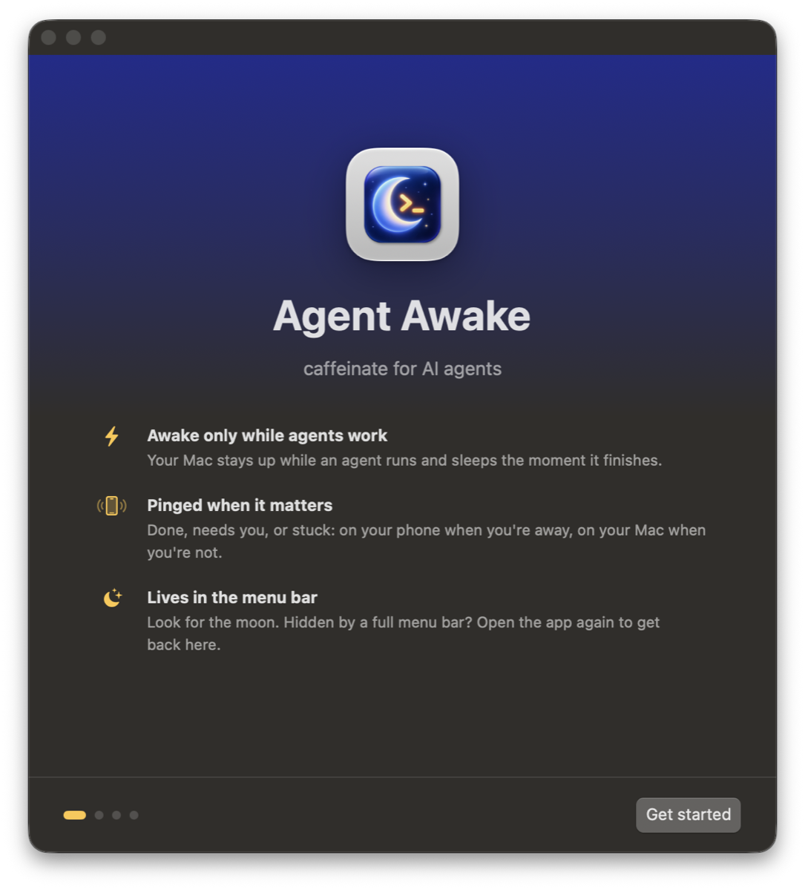
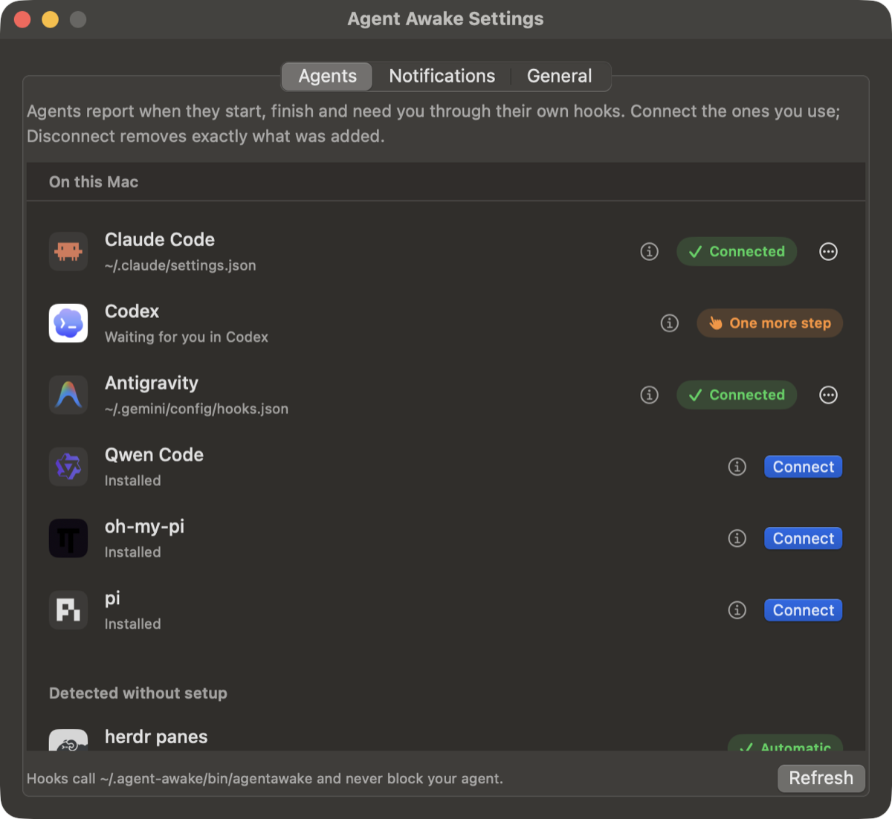

<p align="center"></p>

<h1 align="center">Agent Awake</h1>

<p align="center"><b>caffeinate for AI agents.</b> Your Mac stays awake while agents work,<br>
sleeps the moment they're done, and your phone tells you.</p>

<p align="center">
  <a href="https://github.com/hmrdkn-labs/agent-awake/releases/latest"></a>
  <a href="https://github.com/hmrdkn-labs/agent-awake/actions/workflows/ci.yml"></a>
  
  <a href="LICENSE"></a>
</p>

<p align="center"><a href="https://github.com/hmrdkn-labs/agent-awake/releases/latest"><b>Download for Mac</b></a></p>

<p align="center">
</p>

---

Leaving Claude Code, Codex or a long build running and walking away means choosing between a Mac that
sleeps mid-task and one that burns battery all night with `caffeinate`. Agent Awake holds the Mac awake
**only while work is actually running**, then lets it sleep and pings your phone.

- **Works with your agents, one click each.** Agent Awake connects to each agent's own hooks: it knows
  when a prompt starts, when the turn ends, and when the agent is waiting for you.
- **Awake only while agents work.** While any agent is working the Mac doesn't idle-sleep. When the
  last one finishes, normal sleep comes back by itself. The screen still turns off and locks, to save battery.
- **Pings that matter.** "Fix login bug is done", "Claude Code needs you: Allow Bash?", "stopped with an
  error". They go to your phone only while you're away from the Mac (idle, locked, lid closed). When
  you're at the Mac you get a regular Mac notification instead.
- **Answer from anywhere.** When an agent needs you, the Mac stays awake 15 more minutes so you can
  reply remotely, then sleeps.
- **Not fooled by long builds.** A quiet agent that is still running a build or tests keeps the Mac
  awake. One whose process exited is let go at once, and one that is truly stuck gets you a ping.
- **Backs off when the Mac struggles.** When it runs hot, agents wait before their next step until it
  cools, and the builds they started drop to low priority (or pause, when it overheats). When memory is
  almost full, the largest process an agent started is paused (or stopped, if you choose) before macOS
  starts killing apps.
- **Lid closed (optional).** Keep agents running in your bag. A small privileged helper turns this on only
  while work runs, and turns it off if the battery reaches 10%, gets hot, drains fast (a Mac in a bag), or
  the app quits. With the lid closed the Mac then goes to sleep.
- **Keep awake presets.** 1h, 2h, 4h, or until you turn it off. These also keep the screen on and unlocked,
  like `caffeinate -d`, for when you're watching or presenting.

## Install

Download the DMG from the [latest release](https://github.com/hmrdkn-labs/agent-awake/releases/latest),
drag **Agent Awake** to Applications and open it. It's signed with Developer ID and notarized by Apple.
Requires macOS 13 or later, on Apple silicon or Intel.

The first launch opens a short setup window: connect the agents it found, set up phone pings, and
optionally turn on lid-closed mode. The app then lives in the menu bar as a moon. If you can't find it,
open the app again to bring the window back.

## Supported agents

Connect them in **Settings → Agents**, or with `agentawake connect <id>`. Connecting adds Agent Awake's
hooks next to yours (a backup of the file is kept), and Disconnect removes exactly what it added.
Hooks never block an agent: they print nothing, exit 0 in milliseconds, and do nothing if the app isn't
running.

| Agent | id | Start / done | Needs you | Where |
|---|---|---|---|---|
| Claude Code (CLI, desktop app, IDE) | `claude` | ✓ | ✓ | `~/.claude/settings.json` |
| Codex (CLI, ChatGPT app, IDE) | `codex` | ✓ | ✓ | `~/.codex/hooks.json`, trusted once in Codex |
| Gemini CLI | `gemini` | ✓ | ✓ | extension in `~/.gemini/extensions` |
| Antigravity (IDE, `agy` CLI) | `antigravity` | ✓ | | `~/.gemini/config/hooks.json` |
| Qwen Code | `qwen` | ✓ | ✓ | `~/.qwen/settings.json` |
| Factory Droid | `droid` | ✓ | ✓ | `~/.factory/hooks.json` |
| GitHub Copilot (CLI, VS Code) | `copilot` | ✓ | ✓ | `~/.copilot/hooks/agentawake.json` |
| Devin Local | `devin` | ✓ | ✓ | `~/.config/devin/config.json` |
| OpenCode | `opencode` | ✓ | ✓ | plugin in `~/.config/opencode/plugins` |
| Kilo Code | `kilo` | ✓ | ✓ | plugin in `~/.config/kilo/plugin` |
| Cursor (IDE, CLI) | `cursor` | ✓ | | `~/.cursor/hooks.json` |
| Windsurf Cascade | `windsurf` | ✓ | | `~/.codeium/windsurf/hooks.json` |
| Kiro | `kiro` | ✓ | | `~/.kiro/hooks/agentawake.json` |
| Goose | `goose` | ✓ | | plugin in `~/.agents/plugins` |
| Augment (Auggie) | `auggie` | ✓ | | `~/.augment/settings.json` |
| Junie CLI | `junie` | ✓ | | `~/.junie/config.json` |
| Amp | `amp` | ✓ | ✓ | plugin in `~/.config/amp/plugins` |
| oh-my-pi, pi | `omp`, `pi` | ✓ | ✓ | extension in `~/.omp/agent` / `~/.pi/agent` |

Without any setup, Agent Awake also notices [herdr](https://herdr.dev) panes, and oh-my-pi, Codex and
Zed while they hold the Mac awake for a turn.

Anything else: wrap it, or report from scripts.

```sh
agentawake run build -- make all          # session while the command runs; keeps its exit status
agentawake begin fix-login --timeout 30m  # timeout = max silence before "it may be stuck"
agentawake beat  fix-login
agentawake done  fix-login --message "PR ready"
agentawake list                           # what's keeping the Mac awake
agentawake agents                         # which agents are connected
agentawake strain --wait && start-more   # orchestrators: wait while the Mac is hot or low on memory
```

## Pings

**Settings → Notifications** chooses when pings go to your phone (when away, always, never) and where:

| Channel | Cost | Phones |
|---|---|---|
| [ntfy](https://ntfy.sh) (set up on first run) | free | iPhone, Android |
| [Bark](https://github.com/Finb/Bark) | free | iPhone |
| [Pushover](https://pushover.net) | one-time $5 | iPhone, Android |
| Telegram bot | free | all |
| Discord or Slack webhook | free | all |

By default pings name only the agent and project folder ("Claude Code · shop is done"). Prompts can
hold private text and pings pass through these services, so showing the prompt as the title is opt-in.
Settings live in `~/.agent-awake/config.json` (mode 0600); `AGENT_AWAKE_NTFY_TOPIC` and
`AGENT_AWAKE_NTFY_SERVER` override ntfy.

## Heat and memory

Agent Awake reads the battery and chip temperatures, macOS's thermal pressure level and its memory
pressure level (no root, no permissions). macOS only raises its thermal level once it starts slowing the
chip, which can be long after the case is too hot to hold, so the battery sensor decides first.

| Mac | What happens |
|---|---|
| Hot: battery 41 °C, or macOS slowing the chip | Agents wait before their next tool call until it cools (up to 10 min per call, then they go on). Processes agents started run at background priority. You get one ping when holding starts and one when it ends. |
| Overheating: battery 44 °C | Also pauses every process agents started, until it's back to normal. |
| Memory almost full | Agents wait, and the largest process an agent started (a build, tests, a dev server over 256 MB) is paused, one every 30 s. It continues once memory has stayed below "almost full" for a minute. Settings → General can stop it instead, or only notify. |
| Memory low | Shown in the menu bar only. On a busy Mac macOS can sit at this level for hours, so nobody waits. |

Every minute a line goes to `~/.agent-awake/strain.log` (temperatures, pressure levels, battery, lid), so the
limits can be checked against real days. It stays on your Mac. The 41/44 °C limits come from two days of
that log on a MacBook Pro M4 Pro: 33-38 °C at a desk, 42-43.5 °C after half an hour working in a bag.

Only processes your agents started are touched: never the agents themselves, your apps, or other users'
processes. Nothing stays paused or slowed after Agent Awake quits.

Waiting uses each agent's own pre-tool hook, so it works in Claude Code, Codex, Gemini CLI, Qwen Code,
Factory Droid, Augment, GitHub Copilot, Devin Local, Kiro, Goose, Junie CLI, OpenCode, Kilo Code,
oh-my-pi and pi. Antigravity, Cursor, Windsurf and Amp have no pre-tool hook that can wait without approving
or denying the tool, so they aren't held; their builds are still slowed and paused. Hooks connected before
this feature show as "out of date": Connect again (Codex then asks you to trust the changed hook once).

Orchestrators and scripts can check before starting more work: `agentawake strain --wait` returns when
the Mac is fine (exit 0), or after `--timeout` with exit 75 if it's still strained.

## Lid-closed mode

Off by default. macOS only allows a closed-lid Mac to stay awake with root (`pmset disablesleep`), so a
small helper does exactly that:

- It's installed through `SMAppService` on first use, and you approve it once in System Settings >
  Login Items.
- It accepts a single XPC call from clients signed with its own Team ID and the app's bundle ID: a
  lease of at most 120 seconds, which the app renews every 30 seconds while a session is alive.
- It restores normal sleep when the lease expires (app quit, crash or hang), when the last session
  ends, at 10% battery or less on battery power, when the thermal state is serious, or after it
  restarts from a crash. The app also stops renewing when the battery passes 41 °C or drains faster
  than 20% an hour.
- macOS decides to sleep at the moment the lid closes, and doesn't reconsider when the setting is
  restored later. So if the lid is closed at that point and macOS would normally sleep (no external
  display in use), the helper sleeps the Mac (`pmset sleepnow`, its only other command). Lid-closed mode
  then stays off until you open the lid, so a Mac that cooled down in a bag doesn't start working again.
- Heat is the real risk in a closed bag. Prefer AC power.

## How it works

The app holds a `PreventUserIdleSystemSleep` power assertion (what `caffeinate -i` uses) while any
session is alive. Clients talk to it with one JSON line per request over `~/.agent-awake/daemon.sock`
(mode 0600):

```json
{"cmd": "begin|beat|done|list", "name": "…", "label": "shown in the menu", "timeout": 1800}
```

## Build from source

```sh
swift build && swift test
SIGN_IDENTITY="Developer ID Application: <Name> (<TEAMID>)" scripts/bundle.sh   # dist/Agent Awake.app
xcrun notarytool store-credentials agent-awake --key <AuthKey.p8> --key-id <id> --issuer <uuid>
SIGN_IDENTITY=... scripts/release.sh --schedule   # notarize app + DMG, publish the GitHub release
```

`release.sh` never waits on Apple: each run moves one step (submit, staple, build the DMG, submit, staple,
publish) and exits, and `--schedule` runs it every 5 minutes until it's released. Its log is in
`dist/release-<version>/log`.

`scripts/install-local.sh` updates your installed copy in place and relaunches it. Keep that path: macOS
ties the Login Items and helper approval to it, so a fresh copy somewhere else asks again.

The helper only runs from the signed `.app`, not from `swift run`. `scripts/make-icon.sh` rebuilds the
icon from `assets/brand/icon-source.png`. The Mac App Store isn't possible, because its sandbox forbids
the privileged helper.

## License

MIT
